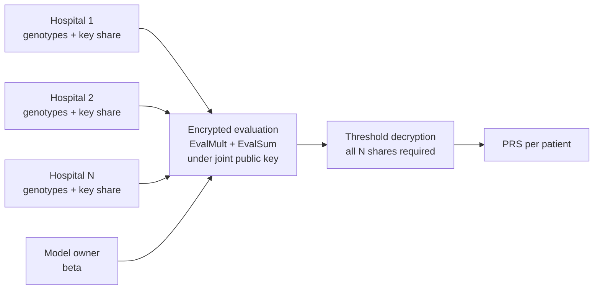

# Multi-party CKKS PRS

Privacy-preserving **Federated Polygenic Risk Scoring (PRS)** using **threshold multi-party CKKS homomorphic encryption** in [OpenFHE](https://github.com/openfheorg/openfhe-development).

Several hospitals each hold genotype data for their own patients, and a model owner holds the PRS weights. Together they compute a risk score for every patient **without any party revealing its raw data, and without any single party holding the decryption key.**

---

## Why this exists

Genomic data is highly sensitive, and hospitals usually cannot pool it. Existing HE-based PRS work (e.g. Knight et al.) relies on a **single key holder**, which assumes that party never colludes with the compute server. This project removes that assumption: the secret key exists only as **N additive shares, one per hospital**, and decryption requires **all N** of them.

## Results at a glance

| Item | Value |
|---|---|
| Scheme | CKKS (threshold / multiparty), OpenFHE 1.5.1 |
| Security level | 128-bit |
| Ring dimension / slots | 16384 / 8192 |
| Multiplicative depth | 1 (scale 2^50) |
| SNPs per patient | 110,000 (packed into 14 ciphertext chunks) |
| Patients per hospital | 400 |
| Parties benchmarked | 2, 3, 5 |
| Total pipeline time (2 parties) | ~138 s |
| Accuracy vs. plaintext | max abs. error ~1e-9 to 6e-9; relative error < 0.0004 % |

> **TODO before publishing:** confirm the patient count used in the 2/3/5-party benchmarks (see [Known issues](#known-issues-and-limitations)) and use a single relative-error figure that matches the report.

---

## Architecture

**Parties**

- **Hospitals (N)**: each holds a genotype matrix (patients x 110,000 SNPs, values 0/1/2) and **one share of the secret key**.
- **Model owner / evaluator**: holds the weight vector β, encrypts it, runs the homomorphic computation, and fuses decryption shares. It holds **no key share**, so it cannot decrypt alone.

**Computation**

```
PRS(patient) = sum_i  beta_i * g_i
```



### 8-phase protocol

| Phase | Description |
|---|---|
| 1 | Create the shared CKKS crypto context |
| 2 | **Chained key generation**: P1 runs `KeyGen`, each Pi runs `MultipartyKeyGen(pk_{i-1})`; the last public key is the joint key. Nobody holds the full secret key. |
| 3 | Joint **EvalMult** (relinearization) key built from per-party shares |
| 4 | Joint **EvalSum** (rotation) keys built from per-party shares |
| 5 | Model owner encrypts β and hospitals encrypt genotypes, all under the joint key (OpenMP-parallel) |
| 6 | Per patient: sum over chunks of `EvalMult(g, beta)`, then `EvalSum` across slots; the score lands in slot 0 |
| 7 | **Threshold decryption**: one lead share, N-1 main shares, then fusion |
| 8 | CSV output, timing, and memory logging |

### Output isolation (Phase 7)

The program variants differ only in Phase 7:

| Version | Phase 7 behavior |
|---|---|
| `multiparty_prs1` | Hospital *h* is the lead for **its own** ciphertexts; the other hospitals send their shares only to *h*, who fuses locally. |
| `multiparty_prs3` | Adds a random **pad/mask** under the joint key, so what gets fused is `PRS + r` rather than the PRS, and the recipient unmasks. Includes an N-of-N self-check: decryption with any one share removed must fail. |

> **Honest scope:** all roles currently run **in a single process**. Isolation is demonstrated and enforced by routing, not by process or network boundaries. Real isolation needs separate processes or machines with real channels.

---

## Repository layout

```
Multi-party-CKKS-PRS/
├── datasets/
│   ├── hospital1.csv ... hospital5.csv   # genotype matrices (rows = patients, cols = SNPs)
│   └── beta.csv                          # PRS weights
├── output/
│   ├── hospitalX_prs.csv                 # encrypted-pipeline PRS per patient
│   └── hospitalX_prs_plaintext.csv       # plaintext reference PRS
├── logs/
├── multiparty_prs3_bigmask.cpp           # multi-party CKKS PRS (masked output)
├── plaintext_prs.cpp                     # plaintext tester / accuracy oracle
└── README.md
```

---

## Building and running

OpenFHE cannot be compiled as a standalone single file, so the sources are built **inside an OpenFHE source tree**.

**Requirements**

- OpenFHE **1.5.1** (built from source with OpenMP enabled)
- C++17 compiler, CMake

**Steps**

1. Copy the `.cpp` files into `openfhe-development/src/pke/examples/`.
2. Copy `datasets/` into `openfhe-development/build/` so it appears as `build/datasets/`.
3. Re-run CMake and build:
   ```bash
   cd openfhe-development/build
   cmake ..
   make -j
   ```
4. Executables are produced in `build/bin/examples/pke/`. Run the multi-party program from `build/`:
   ```bash
   ./bin/examples/pke/multiparty_prs3_bigmask
   ```
   Results are written to `build/output/hospitalX_prs.csv`.
5. Run the plaintext tester (it reads the encrypted output and the datasets):
   ```bash
   ./bin/examples/pke/plaintext_prs
   ```
   It writes `hospitalX_prs_plaintext.csv` and reports **MAE, RMSE, max absolute error, and max relative error**.

> **TODO:** confirm exact executable names, command-line arguments (number of parties), and relative paths against the current source, and note any Windows-specific code (`windows.h` / `psapi.h` memory logging, `_mkdir`).

---

## Data format

- `hospitalX.csv`: one row per patient, one column per SNP, values in {0, 1, 2}. 400 patients x 110,000 SNPs per hospital.
- `beta.csv`: one weight per SNP.

All datasets here are synthetic benchmark data, not real patient genomes.

---

## Known issues and limitations

- **N-of-N decryption**: all hospitals must participate, so one offline hospital blocks decryption.
- **Single-process simulation**: see the note under Phase 7.
- **Duplicated datasets**: `hospital4.csv` is identical to `hospital2.csv`, and `hospital5.csv` to `hospital3.csv`. This is harmless for timing but weakens the 5-party accuracy check.
- **Noise flooding**: the multiparty noise-flooding decryption mode has not been verified for OpenFHE 1.5.1, so leakage-free shares are not claimed.
  
## Future work

- Run each party as a separate process or machine with real communication channels
- Cryptographic output isolation, such as key-switching results to the recipient hospital's key
- Threshold or fault-tolerant decryption (t-of-N) to remove the availability limit
- Distinct data for all five hospitals; fix the beta/SNP alignment

---

## References

1. OpenFHE: https://github.com/openfheorg/openfhe-development
2. Cheon, Kim, Kim, Song. *Homomorphic Encryption for Arithmetic of Approximate Numbers (CKKS)*, 2017.
3. Knight et al. *Privacy-preserving polygenic risk scoring with homomorphic encryption.* <!-- TODO: add full citation from the report -->

## Author

Samarth Kapoor, IIIT Vadodara internship project.
